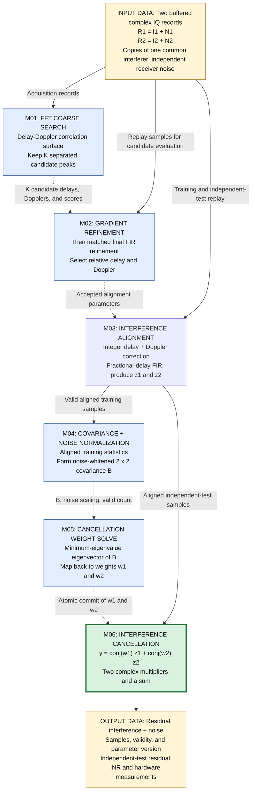
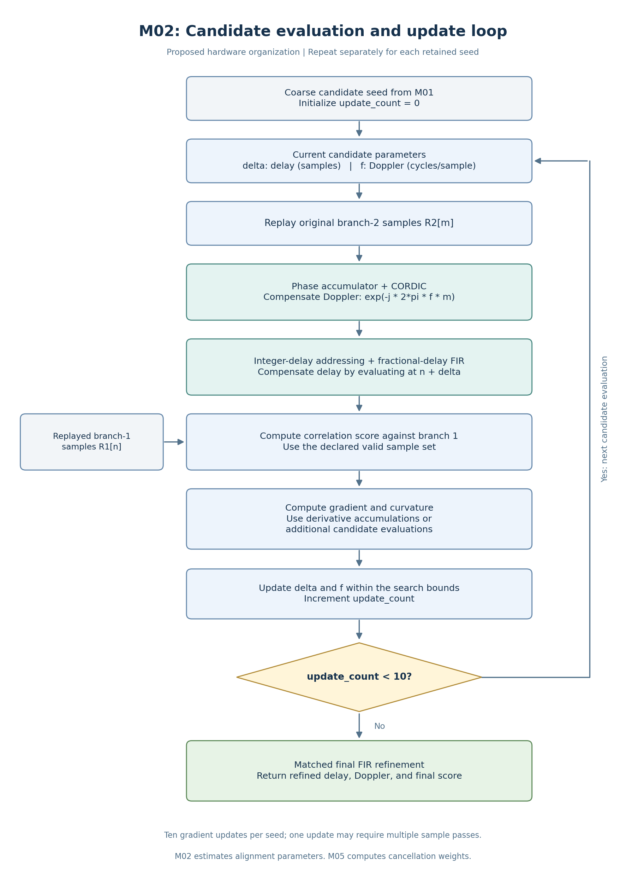
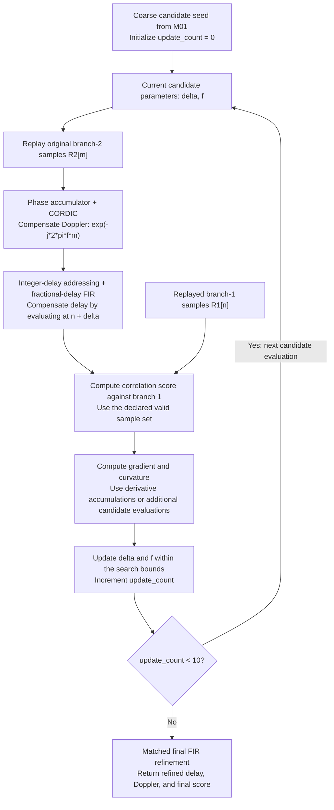
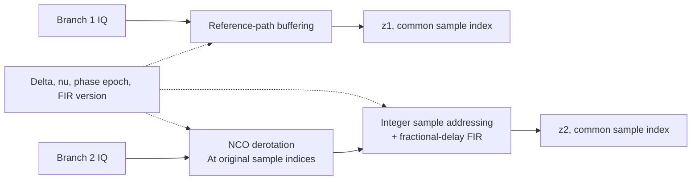
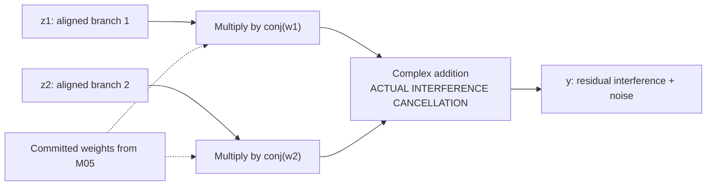
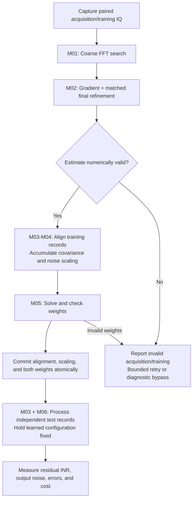

# Paper-Based Interference-Only Cancellation: Modular FPGA Development Plan

**Version:** 3.2 - November 20, 2026\
**Status:** Architecture and development specification; hardware implementation and measured performance remain to be established.\
**Primary references:** the supplied research manuscript described in [references.md](references.md) and the [course source repository](https://github.com/sdrangan/hwdesign), originally inspected as the local `hwdesign_20261118` snapshot.

> **Repository packaging note (November 20, 2026):** This is the expanded research/development plan, preserved from the original standalone document. [plans/initial_plan.md](plans/initial_plan.md) defines the selected course baseline and its explicit PS/PL interfaces. Descriptions of future modules and later hardware migration below are proposals, not implemented results. The manuscript and full course snapshot remain outside this repository.

This design implements the paper's two-branch interference-cancellation experiment. Both inputs contain a received copy of the **same unknown interferer plus receiver noise**. The processing estimates relative delay and Doppler, aligns the copies, learns noise-normalized cancellation weights, and combines the branches destructively.

The current scope contains **no desired signal, desired training reference, equalizer, symbol detector, or payload decoder**. Success means low residual interference on independent test data, with output noise and numerical effects accounted for.

The six processing modules below are the complete main chain. Their IDs are defined within this document. Input buffering, replay, configuration, and result collection are supporting interfaces rather than additional numbered research modules.

## 1. Main architecture



**Solid arrows carry IQ samples. Dashed arrows carry candidate records, estimates, statistics, or weights.** M02 needs both the coarse candidates and replayed IQ. M06 needs both the aligned IQ from M03 and the weights from M05. An FFT score array is never used as the cancellation input waveform.

| Module | Main question it answers | Output |
|---|---|---|
| M01 | Where are promising delay-Doppler matches on a coarse grid? | K separated seeds |
| M02 | What are the refined relative delay and Doppler? | Accepted alignment estimate and quality |
| M03 | How do we make the two interference copies coherent? | Aligned time-domain IQ pair |
| M04 | What are the aligned signal statistics and branch noise powers? | Covariance and noise-normalized covariance |
| M05 | Which normalized complex weights minimize output power? | Two cancellation weights |
| **M06** | **Where is the interference actually cancelled?** | **Weighted-sum output with residual interference and noise** |

**Gradient refinement estimates alignment parameters; it does not directly calculate the cancellation weights.** The weights are learned afterward from aligned covariance. M03 alignment and M04 noise normalization are part of this paper-based baseline, not optional research extensions.

For viewers without Mermaid support:

```text
Parameter learning:
  captured R1, R2 -> M01 coarse FFT search
                 -> M02 gradient + matched final refinement -> delay, Doppler

Weight learning:
  captured R1, R2 -> M03 alignment -> M04 covariance/noise normalization
                                    -> M05 eigenvector solve -> w1, w2

Cancellation after weights are committed:
  independent R1, R2 -> M03 same alignment -> M06 weighted sum -> residual IQ
```

## 2. Scope, inputs, and the paper configuration

### 2.1 Exactly two received signals

```text
R1[n] = I1[n] + N1[n]
R2[n] = I2[n] + N2[n]
```

`I1` and `I2` are received copies of one common transmitted interference waveform `x`. Their amplitudes, phases, propagation delays, and Dopplers can differ. `N1` and `N2` are the respective receiver-noise samples. All these quantities are complex time-domain samples; uppercase `I` means interference, not the in-phase coordinate of IQ.

A useful model is:

```text
Ik[n] = ak * exp(j*2*pi*fk*n) * x[n - tauk],   k = 1, 2

Delta = tau2 - tau1            # relative delay, in samples
nu    = f2 - f1                # relative Doppler, in cycles/sample
nu_hz = nu * Fs
```

The receiver observes only `R1` and `R2`. It is not given the transmitted interference symbols, isolated `I1/I2`, true channel gains, or true delay/Doppler. A simulator may retain those quantities for evaluation and labeled oracle controls.

Our branches 1 and 2 correspond to the paper's branches 0 and 1. This document keeps one-based branch names throughout.

### 2.2 Starting parameters

Use the sparse acquisition path with matched final refinement as the first target. Keep the dense path as a software comparison rather than a second mandatory hardware chain.

| Quantity | Paper reference setting | Implementation meaning |
|---|---|---|
| Effective receive branches | 2; each follows a 36-element array combiner | Start at the two scalar complex-baseband outputs |
| Interference waveform | RRC-shaped QPSK, roll-off 0.25, 3 samples/symbol | A simulation probe; the receiver does not know its random symbol sequence |
| Sample rate | 585937.5 samples/s | About 1.706667 microseconds per sample |
| Record length | N = 1536 samples | 2.62144 ms of observation |
| Reference valid count | Nv = 1222 | Recompute from overlap and filter support for each actual configuration |
| Absolute delays | About 759.6072 / 1026.0767 samples | Preserve both in paper-comparison waveform generation |
| Relative delay | About 266.4696 samples | Include integer and fractional correction |
| Relative Doppler | About -7.8756 kHz, or -20.6454 record-bins | Use signed frequency and a declared phase origin |
| Search limits | +/-600 samples and +/-20 kHz | Bound acquisition, buffers, and runtime |
| Branch power ratio | 0.380244, approximately -4.20 dB | Test unequal received interference powers |
| Fractional-delay filter | 96-tap Kaiser-windowed sinc, shape 9 | Match the reference operator before shortening or replacing it |
| Sparse search | p = 1; K = 1 or 3 separated peaks | Start with K = 1; validate K = 3 near the acquisition transition |
| Gradient stage | 10 curvature-scaled updates; unit step factor in the matched comparison | A bounded estimator, followed by matched final refinement |
| Dense software control | p = 4, six zoom stages, matched final refinement | Comparison for acquisition loss and computational cost |
| Independent test data | 32 interference test blocks per trial | Freeze estimates and weights before evaluation |

These settings come from paper Sections II-B, IV-A, IV-B, Figure 1, and Table I. The paper's nominal 200 MHz is associated with its original link-budget/FFT-block context; the first hardware experiment uses the stated baseband probe sample rate.

The source experiment uses an extended waveform length of 3816 and 1140-sample guards on each side. Preserve those settings and the archived generation procedure when reproducing its curves. A new generator must explicitly define pulse support, absolute delays, guard regions, and valid-record extraction.

### 2.3 What is known and what must be estimated

| Available to processing | Learned from received records | Simulator/evaluation only |
|---|---|---|
| Sample rate, search bounds, record descriptors | Relative delay and Doppler | True delay/Doppler and isolated interference |
| FIR definition and numeric formats | Candidate quality and valid sample region | Wrong-acquisition labels |
| Calibrated or configured input noise variances | Aligned covariance and cancellation weights | Transmitted random interference sequence |

Noise calibration is distinct from interference acquisition. An arbitrary interference-bearing record does not directly reveal its noise-only variance.

## 3. Why the aligned weighted sum cancels interference

After correct relative alignment, the two interference components share the same time-varying waveform and differ by constant complex gains:

```text
z1[n] = a1 * q[n] + noise1[n]
z2[n] = a2 * q[n] + noise2[n]
```

The common waveform `q` may retain an absolute Doppler rotation. Removing that common rotation is unnecessary for the paper's relative-coherence nuller.

M06 applies:

```text
y[n] = conj(w1) * z1[n] + conj(w2) * z2[n]

interference contribution = (conj(w1)*a1 + conj(w2)*a2) * q[n]
```

The ideal weights satisfy `conj(w1)*a1 + conj(w2)*a2 = 0`. M04-M05 learn an approximation to such a direction from the received covariance, without knowing `q` or separately estimating its transmitted symbols.

For a flat, perfectly aligned example with independent unit-power branch noise:

```text
z1 = x   + noise1
z2 = 2*x + noise2
w1 =  2 / sqrt(5)
w2 = -1 / sqrt(5)

y = (2*z1 - z2) / sqrt(5)
  = (2*noise1 - noise2) / sqrt(5)
```

The interference cancels and output noise power remains one. The noise normalization prevents the meaningless solution `w1 = w2 = 0` from being treated as successful cancellation.

If residual delay or Doppler makes the interference copies different waveforms, two constant complex weights generally cannot cancel them over the entire record. This is why acquisition, matched refinement, and alignment are central to this design.

## 4. Module specifications

Every module needs an independent reference model, an input/output contract, deterministic vectors, a numeric model, an implementation, and an acceptance report. The interfaces below are architecture contracts, not already implemented IP.

### 4.1 M01: FFT coarse delay-Doppler search

**Inputs:** paired acquisition records, sample rate, search bounds, grid definition, and K.\
**Outputs:** K separated candidate records containing delay, Doppler, coarse score, and validity.

For an integer-delay direct reference, use the convention:

```text
C(delta, f) = sum over valid n of
    R1[n] * conj(R2[n + delta]) * exp(+j*2*pi*f*(n + delta))

coarse_score(delta, f) = abs(C(delta, f))^2
```

The coarse surface is **unnormalized**, as in the paper. Implement the small-grid direct calculation first, then compare the FFT implementation against it. The FFT accelerates correlation across the search grid; it does not itself remove interference.

The coarse-search implementation must define:

- Linear versus circular correlation and valid lag indexing.
- FFT/IFFT ordering, normalization, zero padding, and block scaling.
- Positive/negative Doppler signs and the conversion from bins to cycles/sample.
- Peak separation, tie breaking, K storage, and zero-energy behavior.
- The exact delay and Doppler hypotheses evaluated at each grid point.

In the paper's grid description, p = 1 corresponds to spacing of one sample and one record-bin; a record-bin is `Fs/N` Hz. N = 1536 is the observation length, not an automatic hardware FFT length. For example, an FFT used to obtain full linear correlation of two N-sample records needs at least `2*N-1 = 3071` points; 4096 is a possible radix-2 length for that operation. This does not by itself establish the paper's Doppler grid. If an FFT length determines frequency spacing, map or evaluate hypotheses appropriately instead of silently changing p.

The course snapshot does not establish a finished two-dimensional interference-search kernel. Select an FFT IP or portable implementation after fixing the golden search formulation and legal transform sizes.

**First acceptance checks:** positive/negative known delay and Doppler, an impulse lag, between-grid offsets, complex correlation agreement with the direct reference, separated peaks, and empty/noise-only records.

### 4.2 M02: Gradient updates and matched final refinement

**Inputs:** M01 seeds plus replay access to the same received records.\
**Outputs:** refined `Delta_hat`, `nu_hat`, final score, valid-region description, and status.

Process each retained seed separately:

1. Initialize the relative delay and Doppler from the seed.
2. Perform ten curvature-scaled gradient updates for the sparse paper path.
3. Run bounded final refinement using the matched fractional-delay FIR operator and normalized objective.
4. Compare candidates using their final normalized scores and select the largest valid result.

#### Candidate evaluation and parameter-update loop

The following is a **proposed hardware organization** for M02. Here, `delta` is the candidate relative delay in samples, and `f` is the candidate relative Doppler in cycles/sample. CORDIC implements the complex rotation used to evaluate a candidate; it does not perform the entire gradient algorithm.



*Figure M02-1. Candidate evaluation, gradient updates, and matched final refinement for each retained seed.* [Open vector version (SVG)](assets/receiver_flow/m02_gradient_candidate_loop.svg).

<details>
<summary>Editable Mermaid diagram source</summary>



</details>

For each candidate, initialize the phase accumulator from its frequency and the original record's reference epoch. Rotate the original samples first, then perform integer/fractional-delay interpolation. Replay both branches with consistent indices and keep the valid mask fixed within the local refinement box.

Complete the current candidate's score and derivative calculations before applying an update. The gradient/curvature engine must follow the selected golden optimizer: a scalar correlation score alone does not supply its derivatives. One gradient update may require multiple sample passes or trial evaluations, so ten updates do not imply ten passes through the record. After matched final refinement, compare the retained seeds using their final scores. This loop outputs alignment parameters; M05 subsequently computes the cancellation weights.

Using the aligned second branch from Section 4.3, the final objective is:

```text
cross  = sum over n in V of R1[n] * conj(aligned_R2[n; delta,f])
energy1 = sum over n in V of abs(R1[n])^2
energy2 = sum over n in V of abs(aligned_R2[n; delta,f])^2

J(delta,f) = abs(cross)^2 / (energy1 * energy2)
```

Maximizing J gives the paper's final alignment estimate. If an implementation calls this "gradient descent," its minimized objective must have the opposite sign, such as `-J`; the update sign must agree with the objective actually used at that stage. The PDF does not completely specify the gradient-stage derivative/curvature implementation, so do not assume that its ten updates are a ready-to-copy generic optimizer.

Keep the valid set V **fixed within each local refinement box** and ensure that all evaluated candidates have the required sample and interpolation support. Exclude nonoverlap and interpolation transients. Reject near-zero energy denominators. In exact arithmetic, a valid normalized correlation score lies between zero and one.

The final refinement must use the same **derotation followed by FIR interpolation** as M03. Ten gradient updates alone are not the complete matched-refinement method in the paper.

For hardware development, separate these internal functions: candidate state, sample replay, score/derivative arithmetic, bounded parameter update, matched final refinement, and winner selection. Freeze iteration limits and termination/status rules before estimating latency.

The PDF leaves executable details such as the peak-exclusion radius, local-box dimensions, curvature safeguards, derivative formulas, and matched-final optimizer tolerances incompletely specified. Recover them from the simulation archive when available. Otherwise record the chosen rules as a documented reimplementation and verify them before claiming reproduction of the paper's results.

The finite-budget experiment in Section IV-E is a separate comparison. Its limited polish changes the overlap mask and uses a different shift/derotation order. Do not mix those settings with the matched-final baseline while retaining the same algorithm label.

**First acceptance checks:** recorded per-iteration trajectories, convergence from controlled seed errors, parameter bounds, flat/ambiguous peaks, score precision, fixed-mask behavior, and agreement between final refinement and M03's actual operator.

### 4.3 M03: Interference delay-Doppler alignment

**Inputs:** paired raw IQ, accepted relative delay/Doppler, sample epoch, and FIR configuration.\
**Outputs:** aligned `z1`, `z2`, common sample indices, valid flags, and alignment version.

Follow paper Equation (6), translated to branches 1 and 2:

```text
z1[n] = R1[n]
z2[n] = aligned_R2[n]
      = exp(-j*2*pi*nu_hat*(n + Delta_hat)) * R2[n + Delta_hat]
```

Fractional arguments describe the ideal interpolation convention. The actual finite-FIR implementation must be used consistently in the reference, final refinement, and cancellation.



Positive `Delta = tau2 - tau1` advances branch 2 mathematically. Hardware achieves this with stored records or sufficient common buffering; it never requests unavailable future samples from an unbuffered live stream. Define integer/fractional splitting and FIR centering for both signs.

First derotate branch-2 samples at their original sample indices, then perform the selected integer/fractional shift. Reversing this order is not generally identical for a finite interpolator. Match the exact finite operator rather than only its ideal continuous-time expression.

Start with the 96-tap Kaiser-sinc operator. Account for filter latency and invalid edges in both branches. NCO phase follows recorded sample time: a replay bus stall does not advance it, while a physical sample gap must be reported rather than silently compressed.

M03 aligns interference but does not cancel it. The remaining constant amplitude/phase difference is handled by M05-M06. A separate absolute carrier-frequency correction is not required for this interference-only nuller.

**First acceptance checks:** signed and fractional delays, signed frequency, sample-epoch consistency, FIR transients, discontinuity-free block replay, and the output noise variance of the actual interpolation filter.

### 4.4 M04: Covariance accumulation and branch-noise normalization

**Inputs:** valid aligned training samples, their count, input noise variances, and the applied FIR/scaling configuration.\
**Outputs:** aligned covariance `Rhat`, noise covariance `Rd`, whitened covariance `B`, and quality/status fields.

For `z[n] = [z1[n], z2[n]]^T`, calculate:

```text
Rhat = mean over valid training n of z[n] * z[n]^H

R11 = mean(abs(z1)^2)
R22 = mean(abs(z2)^2)
R12 = mean(z1 * conj(z2))
R21 = conj(R12)
```

Only four real accumulations are independent: R11, R22, real(R12), and imag(R12). Normalize by the actual valid count. `Rhat` includes interference and noise; it is not a noise-only estimate.

Under independent white input noise and the stated branch-2 interpolation:

```text
noise_gain = sum over taps l of abs(h_delta[l])^2
Rd = diag(sigma1_squared, sigma2_squared * noise_gain)
```

Include any preceding branch gain scaling. For the paper's initially unit-noise coordinates, this reduces to `Rd = diag(1, noise_gain)`.

Let:

```text
D = Rd^(-1/2)
B = D * Rhat * D
```

For diagonal positive Rd, D consists of two positive real inverse-square-root factors. Use configured simulation noise powers for the reference, and a declared calibration or validated estimator for hardware data. Do not substitute the diagonal of Rhat for noise power: those entries contain interference.

This whitening corrects **branch noise powers**, as stated in paper Section II-C. It does not remove temporal noise correlation introduced by interpolation. The selected architecture whitens the covariance and later maps weights back; it does not need an additional whitened IQ stream into M06.

**First acceptance checks:** conjugation, Hermitian symmetry, positive semidefiniteness within numeric tolerance, wide accumulators, valid count, unequal branch noise, measured FIR noise gain, and invalid-noise-variance rejection.

### 4.5 M05: Noise-normalized cancellation weights

**Inputs:** B, D/Rd, valid count, numeric scaling, and the alignment/configuration version.\
**Outputs:** `w1`, `w2`, normalization and quality diagnostics, plus a versioned commit request.

The paper minimizes **noise-normalized total output power**:

```text
minimize over nonzero w:
    (w^H * Rhat * w) / (w^H * Rd * w)

with final normalization:
    w^H * Rd * w = 1
```

Implement the solve as:

```text
v = unit-norm eigenvector of B associated with its smallest eigenvalue
w = D * v
```

Begin with a double-precision Hermitian eigensolver on the host/processing system. Its dimension is only 2 by 2, which keeps the first host-side implementation small and independently testable.

For a later hardware solver, a Hermitian matrix has the form:

```text
B = [[a, b], [conj(b), d]]
lambda_min = (a+d)/2 - sqrt(((a-d)/2)^2 + abs(b)^2)
```

Use scaled, stable arithmetic for the eigenvector and normalization rather than dividing blindly by a small off-diagonal entry. Define behavior for repeated/nearly repeated eigenvalues, negligible signal power, invalid noise scaling, overflow, and an insufficient valid sample count. Report low confidence when the record does not identify a stable cancellation direction.

The eigenvector has an arbitrary global phase. Compare its projector or resulting output power in reference tests, or impose a deterministic phase convention before comparing coefficients directly.

**Do not apply v directly to the original aligned IQ.** M06 receives mapped weights w. Do not renormalize w to Euclidean unit length and still claim unit output noise: the relevant norm is `w^H * Rd * w`.

An existing coefficient-bank manager loads a complete weight/configuration set into an inactive bank and commits it at a defined record boundary. Delay, Doppler, FIR definition, noise scaling, and weights must describe the same processing coordinates. Changing alignment requires consistent retraining before the new weights are applied.

**First acceptance checks:** exact synthetic rank-one interference, unequal complex gains, unequal noise powers, nearly equal eigenvalues, mapped-weight normalization, and quantized output noise/cancellation performance.

### 4.6 M06: Apply the two-branch cancellation weights

**Inputs:** paired aligned samples from M03 and committed weights from M05.\
**Outputs:** residual IQ, valid sample indices, coefficient version, and arithmetic/status flags.



The sample equation is `y[n] = w^H*z[n]`. Choose whether the coefficient memory stores w or conj(w), and keep the convention identical in Python, C++, and RTL. Never conjugate twice.

This module uses two scalar complex weights for a fixed processing block. The 96-tap fractional-delay FIR belongs to M03.

Keep one weight set active across a declared test block. Do not use partial updates or change one branch coefficient earlier than the other. If the channel changes significantly, acquire/train a new configuration on a new block according to a defined update schedule.

The output need not be numerically zero. Receiver noise remains, and alignment error, finite training, interpolation, and fixed-point arithmetic can leave residual interference.

**First acceptance checks:** real and complex cancellation examples, correct conjugation, unit predicted noise power, coefficient bank boundaries, input pairing, stalls, clipping, reset, and sustained output rate.

## 5. Capture, learning, cancellation, and independent evaluation

The first implementation is **capture-then-replay**. It has separate acquisition/weight-learning records and independent test records. "Training" means learning from the received interference-plus-noise observations; it does not mean receiving a known training sequence.



M01, M02, and M04 may use the same learning record, as in the paper. The final evaluation must use new interference/noise realizations. Keep the channel state fixed across a trial's learning and test records for the initial comparison; add channel drift later as a separate experiment.

Replay each interval with consistent sample indices, NCO phase origins, delay addressing, FIR histories, and valid masks. Supply preceding history samples or exclude the declared settling interval. A data block boundary is not automatically a valid FIR output boundary.

The controller must not call an estimate "correct" using the simulator's true parameters. Reject undefined computations such as zero-energy division, missing interpolation support, or nonfinite parameters. Scores and other quality diagnostics can be exported, but they are not equivalent to the paper's truth-based wrong-acquisition label.

**Paper-comparison mode retains every numerically valid selected candidate, including wrong acquisitions.** Their independent-test residuals remain in the unconditional result. Do not discard a valid low-score or wrong-peak trial merely because its cancellation is poor.

A later hardware policy may reject low-confidence records, retain a previous configuration, or use a defined diagnostic bypass. Evaluate that policy separately: report acceptance-conditioned residual INR together with rejection/failure rate. An all-trial operational INR additionally requires a defined fallback output whose residual is included. Report numerical failures explicitly rather than silently removing them from a paper-comparison dataset.

If processing fails, export the failure and any diagnostic samples with invalid status. Do not silently report a bypassed or zeroed output as a successful interference null.

For future continuous operation, use a declared capture/update cadence, sufficient buffering, and a maximum acceptable parameter age. Measure whether acquisition and refinement finish before the estimates become stale. Meeting the streaming sample rate alone does not establish this.

## 6. Interfaces and state rules

### 6.1 Data and parameter records

Begin with signed 16-bit I and 16-bit Q per received branch as a **provisional transport format**, not a final precision decision. Specify binary point, input scale, component order, saturation rules, and byte order before generating hardware vectors. Internal arithmetic will usually be wider.

| Boundary | Required contents |
|---|---|
| Input IQ record | Capture ID, branch ID, common measurement epoch, sample rate, sample count, scale, valid range, and samples |
| M01 candidate | Candidate ID, delay hypothesis, frequency hypothesis, score/scale, and grid version |
| M02 estimate | Delay in samples, Doppler in cycles/sample and/or Hz with explicit conversion, reference epoch, score, overlap/mask information, and status |
| M03 aligned pair | z1/z2, common sample index, valid flag, alignment/FIR version, and scaling |
| M04 statistics | R11/R22/R12, valid count, Rd or its diagonal, B, and configuration version |
| M05 coefficient set | Both complex weights, numeric format, noise norm, quality flags, compatible alignment version, and valid-from boundary |
| M06 output | Residual complex samples, common sample indices, validity, configuration version, and overflow/drop/reset flags |

Keep metadata once per block when possible. If samples and descriptors use different channels, define their ordering, association, and reset behavior. Acquisition FFT arrays and covariance matrices use block interfaces; the alignment and cancellation datapath can use streams.

### 6.2 Parameter units

```text
relative_delay_samples = relative_delay_seconds * Fs
relative_doppler_cycles_per_sample = relative_doppler_hz / Fs
relative_doppler_record_bins = N * relative_doppler_cycles_per_sample
```

Use N from the observation record when reporting the paper's bin units. An internal padded FFT may have a different bin spacing. Do not exchange these bin labels without conversion.

Store full-precision reference values alongside quantized hardware settings in test records. Rounded table values are suitable for orientation; exact archived values are needed for precise paper reproduction.

### 6.3 Streaming and reset behavior

- Transfer a stream item only when both TVALID and TREADY are asserted.
- Hold data and associated metadata stable while stalled.
- Advance replay NCO/filter state according to accepted sample identities.
- Pair branches by measurement epoch, not bus-arrival time.
- Buffer physical acquisition that cannot pause, and flag missing or overwritten samples.
- Define record boundaries explicitly; use TLAST or a separate descriptor contract.
- Reject covariance records with zero valid count or mismatched configuration versions.
- Invalidate incomplete accumulations and coefficient updates on reset.
- Commit all dependent parameters together at a safe boundary.
- Add proper clock-domain crossing where interfaces use different clocks.

These are requirements for the receiver wrappers. The course streaming example does not already implement all of them.

## 7. Numerical precision and implementation budgets

### 7.1 Separate estimation work from sample-rate work

M01-M02 repeatedly examine buffered records. Their cost depends on search size, K, optimizer iterations, FFT arrangement, and memory reuse. M04 accumulates a block of statistics; M05 solves a small matrix problem.

M03 and M06 process every valid replayed sample. Optimize these streaming blocks separately from the acquisition/update engine.

| Work | First reference location | Initial FPGA partition |
|---|---|---|
| M01 FFT search | Python/CPU, direct-versus-FFT checked | FFT/search accelerator after its grid contract is frozen |
| M02 refinement | Python/CPU with bounded loops | Move repeated score/NCO/FIR arithmetic first; control can remain on host/PS |
| M03 alignment | Python finite-operator reference | NCO, delay memory, and fractional-delay FIR in PL |
| M04 statistics | Python high-precision accumulation | Streaming reductions; normalization can initially be on host/PS |
| M05 weights | Host/PS Hermitian eigensolver | Small hardware solver only when measured update latency requires it |
| M06 cancellation | Python complex sum | Two complex multipliers, addition, and coefficient banks in PL |

CPU/PS placement is a development partition, not an omission of the algorithm. Each function remains independently specified and verified.

### 7.2 Throughput, latency, and storage

At a provisional 100 MHz FPGA clock and Fs = 585937.5 samples/s, there are about **170.67 cycles per incoming sample**. This is a planning calculation, not an achieved hardware rate.

```text
Ideal streaming capacity = samples_per_iteration * clock_frequency / achieved_II
Record duration          = N / Fs
Raw IQ storage bytes     = branches * samples_per_branch * bytes_per_complex_sample
```

With two branches and 16-bit I/Q, a pair of 1536-sample records occupies 12,288 bytes. Two such banks occupy 24,576 bytes. Add guard/history samples, FFT workspaces, descriptors, and concurrent capture/processing storage. A pair of 3816-sample extended records alone occupies 30,528 bytes.

Do not store a full delay-Doppler surface by default if a streamed peak search is sufficient. Evaluate bandwidth and candidate retention before choosing BRAM versus external memory. M02 can revisit the same record many times, so its memory-access cost must be measured.

The first update-time budget should separately report:

```text
T_update = T_capture + T_M01 + T_M02
         + T_training_replay_and_M04 + T_M05 + T_commit
         + T_host_PS_transfer_and_control
```

Use the actual acquired length, including any captured guard/history samples, for T_capture; N/Fs is the nominal observation duration. The host/PS term covers transfers and control that are not already included in the measured stage times. Pipeline overlap can reduce elapsed time after it is implemented and measured. Also report M03/M06 streaming throughput, end-to-end sample latency, buffer occupancy, and parameter age.

### 7.3 Fixed-point design

Establish floating-point cancellation first. Then define rounding, saturation, operation order, FFT scaling, and intermediate widths in an executable numeric model.

| Arithmetic | What to control |
|---|---|
| Input IQ | Dynamic range, clipping, common/branch-specific scales |
| FFT/IFFT | Stage scaling, ordering, overflow, and correlation-score scale |
| Correlation and covariance | Product widths, accumulation growth, valid-count division |
| Gradient/curvature | Parameter units, finite-difference or analytic derivative precision, small denominators |
| NCO | Phase word, frequency word, reference epoch, sine/cosine approximation |
| Fractional-delay FIR | Tap quantization, centering, interpolation error, actual noise gain |
| Whitening and eigensolver | Positive noise variances, inverse-square-root range, eigenvalue separation |
| Complex weights and sum | Conjugation, coefficient magnitude, output headroom, and noise normalization |

For bounded accumulation over Nv samples, allow approximately `ceil(log2(Nv))` growth bits beyond a product before accounting for complex additions and precise signed bounds. Derive actual ranges for each expression. A single chosen word length for the entire chain is insufficient.

Use the paper's Equation (21) to understand sensitivity: fixed delay/Doppler bias can create increasing residual interference as input INR grows. Set numeric error budgets by the supported INR range, then test their combined effect. Do not assign an arbitrary number of delay/frequency bits and assume a deep null follows.

For quantized weights, evaluate `w_quantized^H * Rd_actual * w_quantized` explicitly. The ideal unit-noise constraint does not automatically survive coefficient rounding. Clipping or lost samples must be flagged; digital cancellation cannot reconstruct information already lost at the input.

## 8. Validation and metrics

### 8.1 Independent module validation

| Module | Reference comparison | Failure cases to include |
|---|---|---|
| M01 | Direct versus FFT complex correlation and peak indices | Boundary lags, signed frequencies, between-bin peaks, zero energy |
| M02 | Per-iteration parameters and final matched score | Wrong seed, flat curvature, invalid overlap, low energy, iteration limit |
| M03 | Aligned IQ against the same finite interpolation operator | Fractional/sign boundaries, NCO epoch, stalls, resets, missing samples |
| M04 | High-precision covariance and measured noise scaling | Conjugation errors, invalid count, unequal noise, accumulator overflow |
| M05 | Library eigensolver and normalized output power | Degenerate eigenvalues, nearly absent coherent signal, tiny noise variance |
| M06 | Direct complex weighted sum | Weight conjugation, partial commits, branch pairing, saturation |

Useful invariants include Hermitian covariance, nonnegative energy, a normalized score within tolerance of [0,1], and `w^H*Rd*w` close to the specified normalization. For an exactly aligned synthetic rank-one interferer, verify that the learned weight is nearly orthogonal to its branch-gain vector.

### 8.2 Independent-test residual INR

Freeze the estimated alignment and learned weights. Apply them to independent interference realizations with the same channel configuration. The paper uses interference test signals and accounts for output noise through the FIR-derived noise model.

```text
P_interference_out = mean(abs(w^H * z_interference_test[n])^2)
P_noise_out        = w^H * Rd * w
INR_test_linear    = P_interference_out / P_noise_out
INR_test_dB        = 10 * log10(INR_test_linear)
```

The denominator is one only when the implemented weight normalization and actual noise model support that statement. Validate it with independent noise-only input. For a quantized implementation, use the applied filter/coefficient response and compare against measured output noise.

Isolated components are evaluation inputs, not information available to M01-M05. When decomposing a noisy simulation, apply the **same frozen alignment and weights** to its interference and noise components. Never learn a different configuration for each component and combine the resulting powers.

Average results in linear units before converting to dB. For paper-style reporting, average the independent test blocks within each trial, then aggregate trial results and uncertainty. Do not average dB values as a substitute.

The training minimum eigenvalue is not the independent-test residual INR. It includes noise and is affected by fitting and selection on the training record. Total output IQ power by itself also does not identify residual interference power without a noise model or controlled measurement.

### 8.3 Acquisition and hardware measurements

In simulation, the paper labels acquisition correct when:

```text
abs(Delta_hat - Delta_true) <= samples_per_symbol / 2
N * abs(nu_hat - nu_true)   <= 0.5
```

For the stated waveform, the delay threshold is 1.5 samples. These tests require truth and therefore belong to evaluation, not hardware lock logic. Report wrong-acquisition probability, delay/Doppler RMSE, conditional and unconditional residual INR, and failure counts.

Measure search/refinement runtime, update latency, achieved II, samples per second, memory traffic, DSP/LUT/FF/BRAM use, and post-route timing. Include stalls, clock/reset interactions, coefficient age, clipping, and data loss in system tests.

The paper's approximate high-INR reference `2/Nv` is about -27.86 dB for Nv = 1222. It is model-dependent and is not a guaranteed finite-precision floor or a hardware acceptance threshold. Compare against it with the paper's assumptions and independent test procedure stated explicitly.

### 8.4 Scenario ladder and release gates

Start with a flat noiseless interferer and exact alignment, then add unequal gains/phases, input noise, integer delay, fractional delay, and relative Doppler. Progress to unknown alignment and the paper-scale offsets. Sweep input INR, noise imbalance, near-zero correlation, grid boundaries, and channel variation.

Initial completion gates are:

1. The software chain cancels a synthetic common interferer under exact alignment, with correct output-noise normalization.
2. The FFT search agrees with the direct reference, and M02/M03 share the same final operator.
3. Estimated processing improves independent-test residual INR over declared unaligned/single-branch controls across a documented operating range.
4. Fixed-point C and RTL agree with the numeric model and preserve sample/configuration identity under stalls and resets.
5. FPGA replay reproduces accepted vectors and meets the declared streaming and update-time budgets.

Set quantitative residual-INR, failure-probability, precision-loss, and resource targets after the floating-point baseline is measured. No such hardware results are claimed by this document.

## 9. Development order: build separately, then connect

Keep M01-M06 IDs stable even when the implementation order differs from the signal-flow order. Building a small cancellation kernel early makes later estimator errors easier to diagnose.

| Stage | Work | Completion evidence |
|---|---|---|
| 1 | Build an interference/noise generator, record format, and full floating-point paper reference | Saved inputs and outputs at every module boundary; no hardware work yet |
| 2 | Validate M03-M06 using true alignment as a labeled development control | Correct covariance, weights, cancellation, and output-noise power |
| 3 | Implement direct M01 correlation, then FFT M01 and M02 refinement | Estimated alignment matches controlled cases; direct/FFT grid agreement |
| 4 | Run complete M01-M06 estimated processing on independent test blocks | Residual-INR and acquisition curves with documented settings |
| 5 | Implement M06 C/HLS/RTL with host-loaded weights and saved aligned IQ | Correct complex arithmetic, commits, handshakes, and measured cost |
| 6 | Implement M03 NCO/delay/FIR; connect M03 to M06 | Aligned IQ and cancellation match the fixed-point reference |
| 7 | Implement M04 reductions; use M05 on host/PS initially | Hardware statistics produce validated normalized weights |
| 8 | Implement M01 FFT/search acceleration and M02 repeated score arithmetic | Acquisition/refinement accuracy and measured update-time benefit |
| 9 | Integrate capture/replay, parameter management, and FPGA reporting | Full automatic estimated chain and independent-test measurements |
| 10 | Optimize or move M05/control into hardware if needed | A measured latency/resource reason and unchanged accepted behavior |

For each connection, compare intermediate records with the golden model before adding the next block. Preserve diagnostic capture points and clearly labeled oracle/bypass controls for testing; those controls are not the accepted operational result.

## 10. WaveFlow and the course implementation workflow

### 10.1 Use the local snapshot as the implementation reference

Use `E:\advHDW\hwdesign_20261118`, inspected at Git commit `686571d`. The similarly named `hwdesign_20261111` directory is another snapshot. Record the complete course/WaveFlow revisions, Python interpreter, Vitis/Vivado versions, FPGA part, and IP configuration in the implementation project.

WaveFlow organizes the build dependencies, reference generation, verification, and reports. Vitis HLS synthesizes suitable C++ kernels; Vivado integrates and implements the FPGA system. The local example uses handwritten C++, a handwritten testbench, and a Tcl script. It does not automatically implement the paper's mathematics.

The following is the proposed per-module workflow. It extends the checked Python/C/RTL build sequence in the inspected [streaming average-filter example](https://github.com/sdrangan/hwdesign/blob/main/demos/stream/avgfilt/README.md) with receiver-specific numeric modeling, neighboring-module integration, and board validation:


### 10.2 Verify the environment with an existing example

Run these commands in an environment with the required WaveFlow/course packages and vendor toolchain:

```powershell
Set-Location E:\advHDW\hwdesign_20261118\demos\stream\avgfilt
python avgfilt_build.py --list-steps
python avgfilt_build.py --through plot_python
python avgfilt_build.py --through verify_csim
python avgfilt_build.py
```

These are verified example commands, not completed builds for this receiver. Check `--list-steps` for each new module; stage names are not universal across projects.

The example's build script imports `BuildConfig`, `BuildDag`, `BuildStep`, and `SourceStep` from `waveflow.build.build`, and `run_dag_cli` from `waveflow.build.cli`. Custom steps declare inputs/outputs and execute their build work. Reuse that source pattern after confirming the installed API matches the selected snapshot.

Register configuration files as build inputs. If a changed seed, length, or option is not represented in a dependency, use the documented `--force-step` mechanism to prevent stale vectors/results from being mistaken for a fresh run.

The example is free-running AXI Stream and has no TLAST. Add the record/descriptor protocol from Section 6. The FIR demo uses memory ports, so its arithmetic can be reused but its interface is not automatically the streaming alignment module.

### 10.3 Relevant examples

| Course material | Application here |
|---|---|
| [Streaming average filter](https://github.com/sdrangan/hwdesign/blob/main/demos/stream/avgfilt/README.md) | Module skeleton, C/RTL verification, stream timing, M03/M06 wrappers |
| [FIR demo](https://github.com/sdrangan/hwdesign/blob/main/demos/fir/README.md) | M03 interpolation and M02 repeated filtering |
| [Loop optimization](https://github.com/sdrangan/hwdesign/blob/main/demos/loopopt_inclass/README.md) | M01/M02 correlations and M04 accumulation dependencies |
| [Unrolling](https://github.com/sdrangan/hwdesign/blob/main/demos/unroll_inclass/README.md) | MAC parallelism versus memory ports/resources |
| [Data types](https://sdrangan.github.io/hwdesign/docs/demos/datatypes/index.html) and [fixed point](https://sdrangan.github.io/hwdesign/docs/demos/fixp/index.html) | IQ formats, rounding, saturation, and reduction widths |
| [Processor interface](https://sdrangan.github.io/hwdesign/docs/demos/procif/index.html) and [limitations](https://sdrangan.github.io/hwdesign/docs/demos/procif/limitations.html) | Registers/status, host control, bulk-transfer choices |
| [Matched-filter proposal](https://github.com/sdrangan/hwdesign/blob/main/demos/project/matchfilt.md) | FFT correlation concept; this file is a proposal, not a finished interference-search IP |

Use AXI4-Lite for configuration/status and streams/DMA for bulk IQ. Avoid per-sample host register transactions in the datapath.

### 10.4 FPGA and later chip implementation

Select the actual board/part and clock target before estimating deployment resources. The course's 100 MHz / PYNQ-Z2 examples are starting examples, not evidence that this complete design fits that device.

The [FPGA build flow](https://sdrangan.github.io/hwdesign/docs/demos/procif/fpga_build.html) covers IP packaging, block design/wrapper generation, synthesis, implementation, and bitstream/metadata delivery. After integration, inspect post-route timing and utilization, then compare board replay with saved vectors. HLS simulation alone is not board verification.

A later ASIC implementation needs a chosen process/library, memory macros, clock/reset design, test strategy, physical implementation, and signoff flow. Keep FFT, memory, DMA, and FPGA-specific interfaces behind defined wrappers. WaveFlow can organize validated steps, but this plan does not assume an automatic FPGA-to-ASIC conversion.

## 11. Proposed project organization

Keep the receiver implementation separate from the course demos. The following is a proposed layout, not an assertion that these modules already exist:

```text
interference_canceller/
  README.md
  config/
    paper_reference.yaml
    numeric_formats.yaml
    hardware_target.yaml
  model/
    interference_generator.py
    direct_correlation.py
    alignment_operator.py
    reference_chain.py
    metrics.py
  blocks/
    m01_fft_coarse_search/
    m02_gradient_matched_refinement/
    m03_interference_alignment/
    m04_covariance_noise_normalization/
    m05_cancellation_weights/
    m06_weighted_cancellation/
  interfaces/
    capture_replay/
    record_descriptors/
    parameter_banks/
    control_status/
  host/
  integration/
  vectors/
  results/
  fpga/
```

For each block, follow the course's verified source pattern:

```text
spec.md                    # Inputs, outputs, state, formats, and acceptance checks
config.yaml                # Versioned numeric and algorithm settings
<module>_golden.py          # Independent floating/numeric reference and vectors
<module>.h
<module>.cpp               # C++ kernel
tb_<module>.cpp            # Testbench using saved vectors
run.tcl                    # HLS project, device, clock, and simulation steps
<module>_build.py           # WaveFlow build dependencies and verification
<module>_timing.py          # When trace-based timing analysis is applicable
```

Maintain separate numeric and physical-time coordinates in vector files. Save estimates, masks, covariance entries, noise gains, weights, and residual outputs so a failed end-to-end run can be traced to one boundary.

## 12. Decisions to freeze before implementation

| Decision | Required outcome |
|---|---|
| Paper archive availability | Identify exact generator/operator/optimizer source, or label the work a documented reimplementation |
| FFT search layout | Legal transform sizes, actual hypotheses, normalization, lag signs, and memory schedule |
| Candidate rules | K, separation radius, tie-breaking, quality/status rules |
| Refinement | Objective at each stage, curvature/gradient calculation, bounds, stopping rules, and matched-final budget |
| Alignment FIR | Exact tap generation, centering, coefficient normalization, numeric precision, and mask endpoints |
| Noise model | Input variances/calibration, gain scaling, FIR noise gain, and validity conditions |
| Weight solver | Eigensolver reference, numerical safeguards, normalization, degeneracy policy, and coefficient format |
| Hardware interface | Sample packing, descriptors, epochs, replay protocol, and atomic update boundary |
| Performance targets | Supported input INR/offset/drift range, residual-INR loss budget, update deadline, and resource ceiling |

The paper specifies the scientific chain and its reported experiment; it does not provide every executable or hardware-level choice. These decisions must become explicit configuration and module contracts, not hidden assumptions in implementation.

The first concrete development deliverable is a floating-point interference-only reference with saved M01-M06 boundary vectors and independent-test residual-INR measurements. That gives each hardware module a stable target before integration begins.

## 13. Paper traceability and glossary

| Design item | Source in the supplied paper |
|---|---|
| Two observations of one common interferer | Section II-A, Equations (3)-(5) |
| Coarse FFT search, gradient seeds, matched final refinement | Section II-B, Figure 1, Section IV-B |
| Relative alignment operator | Equation (6) |
| Final normalized score and parameter selection | Equations (7)-(8) |
| Aligned covariance and minimum-eigenvector nuller | Equations (9)-(10) |
| Branch-noise normalization and mapped weights | Equation (12), Section II-C |
| Acquisition truth criterion | Section III-A |
| Waveform/channel settings and independent test blocks | Table I, Section IV-A |
| Matched versus limited-budget refinement distinction | Sections IV-B and IV-E |
| Residual-INR approximation and fixed-bias sensitivity | Equations (16), (20), and (21) |

| Term | Meaning in this design |
|---|---|
| IQ | Real and imaginary components of a complex sample |
| Coarse search | Search on a discrete delay-Doppler grid |
| Gradient refinement | Local adjustment of delay/Doppler estimates using slope and curvature information |
| Matched final refinement | Final estimation using the same finite alignment operator as cancellation |
| NCO | Numerically controlled oscillator used for Doppler derotation |
| FIR | Finite impulse response filter; here primarily fractional-delay interpolation |
| Covariance | Average second-order relationships between aligned branch samples |
| Whitening | Here, normalization of branch noise powers |
| Nulling weight | Complex combining coefficient chosen to suppress the common waveform |
| INR | Interference-to-noise power ratio, averaged in linear units before reporting dB |
| PS / PL | Processing system / programmable logic |
| HLS / RTL | High-level synthesis / register-transfer-level hardware description |
| II | Initiation interval: cycles between accepted pipeline iterations |
| Golden model | Independently checked reference behavior for module verification |
