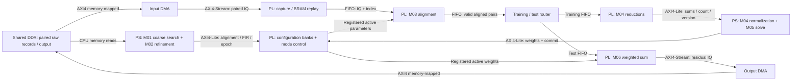

# Initial Plan: Two-Branch Interference Cancellation IP

**Project / repository name:** `mixed_training_receiver_flow`\
**Date:** November 20, 2026\
**Status:** Proposed architecture; RTL/HLS implementation, board validation, and measured performance are future work.\
**Submission artifact:** This file, `plans/initial_plan.md`, in the public project repository.

## 1. Project Team

**SJ00425 — sole contributor.** Responsible for the reference model, hardware modules, verification, PS integration, and documentation.

## 2. IP Definition

### Purpose and operating scope

The project will build a modular FPGA accelerator for cancelling one unknown interferer observed by two receivers. Each input is a complex baseband record containing a differently delayed, Doppler-shifted, and scaled copy of the same interferer plus independent receiver noise. The receiver estimates relative delay and Doppler, aligns the records, learns noise-normalized combining weights, and outputs residual interference plus noise.

The first implementation uses **capture and replay** from PS (processing system) memory. The PS runs acquisition and parameter estimation, sends paired IQ samples to PL (programmable logic), configures the accelerator, and retrieves statistics and output samples. There is no live RF/ADC interface in this initial scope. There is also no desired signal, known training-symbol reference, equalizer, or payload decoder: “training” means learning from interference-plus-noise observations.

Starting experiment settings are `Fs = 585937.5 samples/s`, observation length `N = 1536`, delay search within `+/-600 samples`, Doppler search within `+/-20 kHz`, and a 96-tap Kaiser-windowed sinc interpolator with shape parameter 9. These come from the supplied manuscript identified in [References](../references.md); they are starting settings rather than achieved hardware capabilities.

### Mathematical definition

Let `j = sqrt(-1)`, `conj()` denote complex conjugation, and `H` denote conjugate transpose. Frequencies below are in cycles/sample; delays are in samples. Original record indices and the phase epoch are retained during every replay.

```text
Rk[n] = ak * exp(j*2*pi*fk*n) * x[n - tauk] + Nk[n],  k = 1, 2
Delta = tau2 - tau1
nu = f2 - f1
```

The waveform `x`, gains, and true offsets are unknown to the receiver. Configured or calibrated input noise powers are available separately. The six algorithm modules compute:

**M01 — coarse delay-Doppler search.** For integer lag `d` and each Doppler hypothesis `f`, evaluate linear cross-correlation and retain `K` separated peaks of its unnormalized magnitude squared:

```text
C(d,f) = sum_valid_n R1[n] * conj(R2[n+d]) * exp(j*2*pi*f*(n+d))
score(d,f) = abs(C(d,f))**2
```

Start with `K = 1`; compare `K = 3` in software. FFT-based linear correlation will be checked against a direct sum. `N` is the observation length: a full linear correlation needs at least `2*N-1` transform points, so 4096 is a candidate padded FFT size. Doppler hypotheses use the observation-bin spacing `Fs/N`, independently of that padding.

**M02–M03 — refinement and alignment.** Refine each seed, then align branch 2. The ideal convention is:

```text
z1[n] = R1[n]
z2[n] = exp(-j*2*pi*nu_hat*(n + Delta_hat)) * R2[n + Delta_hat]
```

For the actual finite implementation, first derotate `R2[m]` at its original sample index `m`, then apply integer addressing and the fractional-delay FIR. Positive delay advances branch 2 by reading buffered samples. M02's final objective uses exactly this same finite operator:

```text
J(delta,f) = abs(sum_V R1[n] * conj(aligned_R2[n;delta,f]))**2
             / (sum_V abs(R1[n])**2 * sum_V abs(aligned_R2[n;delta,f])**2)
```

The planned sparse path uses ten bounded curvature-scaled gradient updates per seed, followed by bounded local refinement of `J` with the matched FIR. The precise derivative rules, safeguards, final iteration cap, and FIR centering will be frozen in the reference model before hardware work; the manuscript does not provide every executable detail. Keep valid set `V` fixed inside each local refinement region, exclude unsupported FIR edges, and reject zero-energy denominators.

**M04–M05 — statistics and weight learning.** For the aligned training samples:

```text
Rhat = mean_V outer(z[n], conj(z[n]))    # z = [z1, z2]^T
Rd = diag(sigma1_squared, sigma2_squared * sum_l abs(h[l])**2)
D = inverse_sqrt(Rd)                    # positive diagonal noise scaling
B = D @ Rhat @ D
v = unit_norm_minimum_eigenvalue_eigenvector(B)
w = D @ v                              # w^H @ Rd @ w = 1
```

`h` is the actual branch-2 interpolation filter. `Rd` models independent white input noise after interpolation, including any input gain scaling. Its entries must not be replaced with `diag(Rhat)`, which includes interference. The weight solve minimizes `w^H Rhat w` subject to `w^H Rd w = 1`; this prevents zero weights from being a trivial solution.

**M06 — cancellation.** Freeze the learned configuration and apply it to independent test records:

```text
y[n] = conj(w1) * z1[n] + conj(w2) * z2[n]
```

For perfectly aligned interference `z1 = a1*q + noise1`, `z2 = a2*q + noise2`, a weight direction satisfying `conj(w1)*a1 + conj(w2)*a2 = 0` cancels the shared waveform. Noise and estimation/quantization residuals remain. Evaluation uses new interference and noise realizations; simulator truth is used only to measure performance, never to choose operational weights.

### Why hardware acceleration fits

Alignment repeatedly performs complex rotations and a 96-tap FIR; covariance requires four independent real reductions; cancellation requires two complex multiplications and an addition for every valid sample. These operations have regular memory access and reusable multiply-accumulate datapaths. Pipelining across samples, limited tap parallelism, and concurrent reductions can reduce repeated CPU work while FIFOs connect independently testable blocks. The small 2-by-2 eigensolve and iterative acquisition control run only when parameters change, so they initially remain on PS.

## 3. IP Architecture

### Architecture alternatives and selected partition

The AI-assisted architecture review compared three decompositions:

| Option | PL implementation | Decision |
|---|---|---|
| A: Combiner only | M06; all alignment and learning on PS | Useful first bring-up milestone, but leaves the FIR and statistics workload on the CPU. |
| **B: Sample processing accelerator** | **M03 alignment, M04 reductions, M06 cancellation; capture/replay and configuration wrappers** | **Selected initial design.** Substantial sample-level arithmetic with manageable buffering and independently testable modules. |
| C: Complete hardware acquisition chain | M01–M06, including FFT search and iterative refinement | Stretch goal after measurements; repeated candidate replay, FFT storage, optimizer control, and solver precision increase cost. |

All six functions remain in the complete receiver. This partition specifies which are software and which are custom hardware; no PS computation is claimed as implemented PL.

### Modules and dataflow

| Module | First location | Function and decomposition |
|---|---|---|
| Capture/replay wrapper | PL + DMA | Receive a paired record, retain it in BRAM, check length, and replay original sample indices. Separate ingress, replay-address control, and completion status. |
| M01: Coarse search | PS | Read captured records in DDR, run FFT correlations, and produce candidate delay/frequency/score records. |
| M02: Refinement | PS | Read candidates and the same raw records; evaluate bounded local updates and the matched final objective. Output alignment parameters, valid range, and quality status. |
| M03: Alignment | PL | Separate reference-path buffer, branch-2 NCO/complex rotator, and integer/fractional-delay FIR. Pair outputs at a common sample index and exclude invalid edges. |
| M04: Statistics | PL reductions + PS normalization | PL accumulates `sum(abs(z1)^2)`, `sum(abs(z2)^2)`, and real/imaginary parts of `sum(z1*conj(z2))`. PS divides by the valid count and forms `Rd`, `D`, and `B`. |
| M05: Weight solve | PS | Solve the Hermitian 2-by-2 problem in floating point, map `v` to `w`, check noise normalization and degeneracy, and prepare the next parameter bank. |
| M06: Weighted sum | PL | Two complex multipliers and an adder use one committed coefficient set. Export residual IQ and arithmetic status. |
| Configuration/mode controller | PL | Hold shadow and active configurations; route training samples to M04 and test samples to M06. Commit complete parameters only between records. |



The interface table below is also a text description of every connection; reading the diagram is not required.

### Interface contracts

| Connection | Type | Information carried |
|---|---|---|
| PS / M01 / M02 / M05 | Shared DDR / software records | Raw arrays; `K` candidate tuples `(delay, Doppler, score)`; refined estimates; covariance/noise matrices; weights; record and configuration IDs. |
| DDR ↔ input/output DMA | AXI4 memory-mapped shared memory | Packed input and output arrays; PS configures buffer addresses and byte counts through DMA control registers. PS performs required cache flush/invalidate operations. |
| Input DMA → capture | 64-bit AXI4-Stream | One paired sample per beat: `[15:0]=Re(R1)`, `[31:16]=Im(R1)`, `[47:32]=Re(R2)`, `[63:48]=Im(R2)`, each signed 16-bit. `TLAST` ends the record; all bytes are valid. |
| Capture → replay → M03 | Shared on-chip BRAM, then bounded FIFO | Stored paired IQ, original index, and end marker. The reference path is buffered to match branch-2 delay/FIR latency. |
| Inside M03 | Bounded FIFOs + coefficient RAM | Indexed IQ from replay to rotator to FIR, with reference samples and valid/index metadata. Read-only active FIR coefficients and NCO parameters come from the configuration bank. |
| M03 → router → M04 **or** M06 | Bounded FIFOs | `z1`, `z2`, common index, valid flag, configuration ID, and end marker. Training and test are separate modes; samples are not sent into an unconsumed branch. |
| M04 → PS | AXI4-Lite result registers | Four wide real sums, actual valid count, record/configuration IDs, overflow flags, and done/error. Results remain latched until acknowledged so multiword reads are consistent. |
| PS → configuration controller | AXI4-Lite registers / coefficient window | Mode, length, valid range, delay, Doppler, epoch, FIR taps/format, scales, both complex weights, version, start, and atomic commit. The controller distributes stable registered parameters to M03/M06 and mode/status signals to the wrappers. |
| M06 → output DMA → DDR | AXI4-Stream, then AXI4 memory-mapped | 64-bit output beats: signed 32-bit real and imaginary residual components; `TLAST` marks the final retained sample. Output count, first index, configuration ID, and errors are read through AXI4-Lite status. |

Each run has one descriptor and one record in flight. PS programs the descriptor before data transfer; the paired input beat avoids branch skew. Output samples are the contiguous valid range, so the first index and count identify them without extra DMA sideband metadata. Input scaling, binary points, output rounding/saturation, and internal widths will be frozen after a fixed-point sweep; 16-bit input components are a transport starting point, not an accuracy guarantee.

FIFO/AXI transfers advance state only when accepted. AXI sources hold payload stable under backpressure. NCO phase follows recorded sample identity, not wall-clock cycles. Incorrect lengths, missing support, clipping, or reset invalidate the record. To train a new alignment, activate its alignment/FIR configuration between records in training mode with M06 disabled. After M04/M05 finish, commit the matching alignment/FIR/weights and version together for test mode. Reset clears partial statistics and pending commits.

Before test replay, PS verifies that the valid output count is positive and arms the output DMA for that count before starting the input transfer. A truncated or invalid transfer that cannot finish with the expected `TLAST` triggers a bounded timeout and abort/reset of the DMA and PL transaction, rather than leaving either side waiting indefinitely.

### Execution, feasibility, and verification

Execution is: **PS acquisition/refinement → training replay through M03/M04 → PS normalization/solve → atomic parameter commit → independent test replay through M03/M06**. Estimates stay fixed across the test data. Invalid numerical estimates produce an explicit failure; zeroed output is never counted as successful cancellation.

At a provisional 100 MHz PL clock, the experiment's sample rate allows approximately 170.67 cycles per input pair. A 1536-sample paired record requires 12,288 bytes at the proposed input format; two buffers require 24,576 bytes before guards, history, coefficients, or wider intermediates. Extended 3816-sample record pairs require 30,528 bytes each. A time-multiplexed FIR is therefore a candidate worth synthesizing; memory ports, accumulation dependencies, and measured timing will determine the schedule. The target is sustained replay at least at `Fs`; acquisition/update latency is measured separately, with no claim of real-time reacquisition yet.

Development proceeds in small milestones: (1) floating-point M01–M06 reference with saved module boundaries; (2) DMA loopback and M06 with host-loaded weights; (3) M03 signed/fractional delay and Doppler; (4) M04 and PS weight learning; (5) integrated training/test replay, fixed-point tuning, and board measurements. M01/M02 acceleration is optional after this baseline works.

Verification will compare direct versus FFT correlation, known signed offsets, matched FIR alignment, covariance/conjugation, and `w^H Rd w`. Independent test blocks will measure residual INR using separately retained interference/noise components under the same frozen processing, plus output-noise power and acquisition failures. Start with 32 independent test blocks per trial and test unequal branch noise, between-grid offsets, zero input, and high INR. Hardware checks will include bit-accurate C/RTL comparison, stalls, reset, parameter commits, and measured throughput, latency, DSP/LUT/FF/BRAM use, and timing. No measured results are claimed at this planning stage.

The expanded research design is preserved in [mixed_training_receiver_flow.md](../mixed_training_receiver_flow.md). This initial plan defines the selected first implementation scope; that longer document also discusses later extensions. Interface implementation will follow the [AMD Vitis HLS interface guide](https://docs.amd.com/r/en-US/ug1399-vitis-hls/AXI4-Stream-Interfaces).
